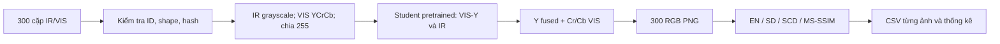

# Bàn giao phần việc Lộc lớn — SAGE baseline M³FD Fusion

Ngày lập bàn giao: **16/11/2026**. Người thực hiện: **Lộc lớn**.

## 1. Phạm vi và trạng thái

Theo phân công ngày 14/11: chạy SAGE baseline trên M³FD Fusion, chuẩn hóa evaluator
fusion và bàn giao **300 ảnh fused cùng EN/SD/SCD/MS-SSIM**.

**Đã hoàn thành thực nghiệm tại workspace:** 300/300 ảnh, 0 ảnh lỗi. Mã nguồn,
notebook, manifest và bảng kết quả đã được push lên `feature/loclon-evaluation`,
commit [`87b46f0`](https://github.com/quan14333/xulianh/commit/87b46f09b7d6922034de099ae279d8703f167776),
trong [PR #6](https://github.com/quan14333/xulianh/pull/6). Đây là bàn giao để nhóm
review; không đồng nghĩa PR đã được nghiệm thu hoặc merge.

Ảnh lớn đã đóng gói tại máy người thực hiện. **Chưa tải ZIP lên GitHub hoặc storage
chung**; người nhận cần nhận riêng ZIP để kiểm tra toàn bộ 300 ảnh.

## 2. Nguồn mô hình và phần code bổ sung

| Thành phần | Nguồn / vai trò |
|---|---|
| Kiến trúc Student | `model_sub/model.py` từ [SAGE_IVIF chính thức](https://github.com/RollingPlain/SAGE_IVIF), MIT |
| Phiên bản upstream | `377fdbef6b8b6ccbd1139358ad66bb41ea084dc1` |
| Trọng số | `checkpoints/checkpoints.pt` pretrained từ upstream, cùng hash checkpoint baseline FMB |
| Runner do nhóm bổ sung | [`run_m3fd_baseline.py`](../scripts/run_m3fd_baseline.py): kiểm tra dữ liệu, inference CPU/CUDA, lưu ảnh, chấm và ghi provenance |
| Evaluator | [`src/evaluation/`](../src/evaluation/): dùng mã trong repo nhóm, sửa histogram EN và phép tổng hợp bản đồ SSIM/MS-SSIM |
| Notebook | [`SAGE_M3FD_Baseline.ipynb`](../notebooks/loc_lon/SAGE_M3FD_Baseline.ipynb): gọi lại runner |

Đây là **tái lập inference Student pretrained**, không phải tự huấn luyện lại
Teacher/Student. Phạm vi này không chạy SAM hoặc SegFormer và không báo mIoU.

Checkpoint SHA-256:

```text
ecfde477ca4cd65401f207d5dc91ce6c475a49891d768dbdb7a66366255ee836
```

## 3. Pipeline đã chạy



Giữ nguyên độ phân giải, batch size 1, seed 2. Run đã chạy bằng CPU.
Adapter dùng đường dẫn model thực tế và ma trận chuyển màu trên device được chọn;
không sửa kiến trúc hay trọng số upstream.

## 4. Kết quả thực nghiệm

- Run ID: `20261114T055320Z_sage_m3fd_student`.
- Protocol: `loclon_m3fd_y_reflect_v2`.
- Tổng thời gian inference, chấm và ghi ảnh: **682,8 giây**.

| Metric gốc | Mean | Std (ddof=0) | Median | Số ảnh hợp lệ |
|---|---:|---:|---:|---:|
| EN | 6.850129 | 0.388626 | 6.910206 | 300 |
| SD | 36.463395 | 10.069931 | 35.281462 | 300 |
| SCD | 1.693912 | 0.173752 | 1.746614 | 300 |
| MS-SSIM | 0.755681 | 0.064647 | 0.772774 | 300 |

Chấm ảnh PNG đã lưu, dùng kênh Y BT.601, float64, miền 0–255. MS-SSIM chính là
trung bình hai nguồn IR/VIS; CSV có cả hai thành phần và tổng. Bảng trên không
nhân hệ số biểu đồ.

Protocol của nhóm **chưa được xác nhận tương đương evaluator của paper SAGE**.
Các bảng parity trước ngày 14/11 thuộc phiên bản cũ, không xác minh v2.
Chi tiết: [`M3FD_PROTOCOL.md`](../notebooks/loc_lon/M3FD_PROTOCOL.md).

## 5. Danh mục bàn giao

| Nội dung | Vị trí trong repo |
|---|---|
| Hướng dẫn protocol và tái lập | [`M3FD_PROTOCOL.md`](../notebooks/loc_lon/M3FD_PROTOCOL.md) |
| Config bốn metric | [`m3fd_fusion.yaml`](../configs/evaluation/m3fd_fusion.yaml) |
| Bảng tổng hợp | [`m3fd_summary.csv`](../reports/tables/loc_lon/m3fd_summary.csv) |
| Metric từng ảnh | [`m3fd_per_image.csv`](../reports/tables/loc_lon/m3fd_per_image.csv) |
| Manifest 300 cặp, kích thước và hash | [`m3fd_manifest.csv`](../reports/tables/loc_lon/m3fd_manifest.csv) |
| Run config và hash mã nguồn | [`m3fd_run_config.json`](../reports/tables/loc_lon/m3fd_run_config.json) |
| Môi trường thực tế | [`m3fd_environment.json`](../reports/tables/loc_lon/m3fd_environment.json) |
| Kiểm tra artifact sau chạy | [`m3fd_validation_report.json`](../reports/tables/loc_lon/m3fd_validation_report.json) |
| Metadata ZIP | [`m3fd_artifact.json`](../reports/tables/loc_lon/m3fd_artifact.json) |
| Báo cáo ngày chạy | [`loc_lon_2026-11-14.md`](../reports/weekly/loc_lon_2026-11-14.md) |
| Test bổ sung | [`test_m3fd_baseline.py`](../tests/test_m3fd_baseline.py) |

Artifact lớn tại workspace người thực hiện:

```text
runs/20261114_sage_m3fd_loclon_v2/
  fused/                         # 300 ảnh RGB PNG
  metrics/per_image.csv
  metrics/summary.json
  manifest.csv
  inference.csv                  # SHA-256 từng ảnh fused và thời gian
  run_config.json
  environment.json
  logs/run.log
  figures/preview_ir_vis_sage.png
  validation_report.json
  artifact_manifest.json
  HANDOFF.md

runs/loclon_sage_m3fd_300.zip     # 289830309 bytes, khoảng 277 MiB
```

ZIP gồm run và bản sao mã phục vụ tái lập; không chứa dataset nguồn hoặc checkpoint.
SHA-256 của ZIP gốc:

```text
3d43a03b6a409ea491affd44c73e81788b5a013fa870defb0cb08c2a5383e2ff
```

Đường dẫn `runs/...` là đường dẫn local, không phải link tải trên GitHub. Không
thêm ZIP vào Git thường. Khi đưa lên storage chung, bổ sung URL tải vào mục này.

## 6. Chạy lại

Từ thư mục gốc repo, dùng Python >=3.10 và môi trường PyTorch CPU/CUDA phù hợp.
Chuẩn bị đúng **M3FD Fusion 300 cặp**, đặt tại `data/raw/M3FD_Fusion/Ir` và `Vis`;
không thay bằng bộ M3FD Detection.

```bash
python -m venv .venv
source .venv/bin/activate
python -m pip install -r requirements-inference.txt

# Clone khi chưa có external/SAGE_IVIF; nếu đã có, kiểm tra commit trước khi chạy.
git clone https://github.com/RollingPlain/SAGE_IVIF.git external/SAGE_IVIF
git -C external/SAGE_IVIF checkout 377fdbef6b8b6ccbd1139358ad66bb41ea084dc1

python scripts/run_m3fd_baseline.py --audit-only
python scripts/run_m3fd_baseline.py --device cpu --threads 4
```

Trên máy có CUDA, dùng `--device cuda`. Runner tự tạo run mới; từ chối ghi đè
thư mục cũ. Có thể chọn thư mục mới bằng `--output-dir runs/<ten-run-moi>`.
Xem environment đã bàn giao để nhận diện phiên bản package thực tế; requirements
là khoảng phiên bản cho phép, không phải lockfile tái tạo tuyệt đối môi trường.

## 7. Kiểm chứng và hướng dẫn người nhận

Đã chạy đạt **84 tests CPU**, compileall, repository validator và Ruff trên các
module thay đổi. Test MS-SSIM dùng Gaussian 2D trực tiếp độc lập để đối chiếu
convolution separable, gồm đủ 5 scales.

Đã đọc lại đủ 300 PNG, kiểm tra đúng ID/kích thước/RGB, hash nguồn và fused,
metric hữu hạn, tính lại mean/std/median từ CSV và kiểm tra tính toàn vẹn ZIP.

Người nhận thực hiện:

1. Review mã và bảng kết quả trên nhánh/PR liên kết ở mục 1.
2. Nhận riêng `loclon_sage_m3fd_300.zip` từ Lộc lớn; đối chiếu SHA-256 ở mục 5.
3. Giải nén, đối chiếu 300 ảnh với manifest và `inference.csv`; xem preview và log.
4. Dùng đúng protocol v2 khi so sánh phương pháp mới; không gộp số của evaluator cũ.
5. Ghi nhận review/nghiệm thu và nơi lưu artifact chung khi nhóm hoàn tất.

Lệnh kiểm tra ZIP trên Linux:

```bash
sha256sum runs/loclon_sage_m3fd_300.zip
```

Việc xác nhận tương đương evaluator paper và nghiệm thu của nhóm chưa được thực
hiện trong tài liệu này. Các số liệu là kết quả chạy thật của nhóm trên checkpoint
pretrained, không phải số công bố của tác giả.
