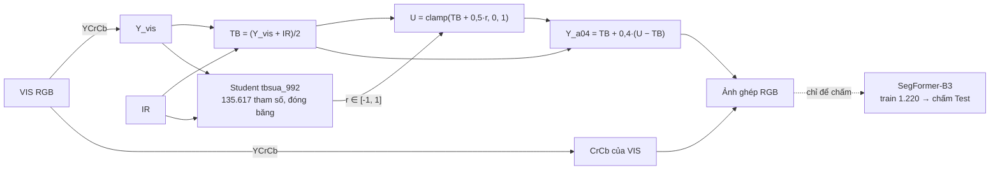

# Method card – a04: "Ghép TB + 40 % phần sửa" (phần của Mân)

*Khóa 26/11/2026 trên Dev228. Bằng chứng khóa: [`FROZEN_MANIFEST.json`](../../reports/experiments/man_a04/FROZEN_MANIFEST.json).
Kết quả đầy đủ: [`reports/experiments/man_a04/`](../../reports/experiments/man_a04/README.md).*

## 1. Bài toán và loại đầu ra

- **Input:** cặp ảnh đã căn chỉnh VIS (RGB) + IR (1 kênh) của FMB.
- **Output:** **ảnh ghép RGB** (kênh Y mới + CrCb của VIS). Không sinh mask.
- **Đánh giá:** chỉ số ghép (MS-SSIM, Q_ABF, SCD, EN, SD) và mIoU downstream qua một giao thức SegFormer-B3 chung
  (train SegFormer trên ảnh ghép, chấm Test), như bài SAGE.

## 2. Giả thuyết

1. Trên FMB, ghép trung bình **TB = (Y_vis + IR)/2** đã cho mIoU downstream cao hơn SAGE (baseline B3 của nhóm: TB 64,4 so với
   SAGE 63,4, 3 seed). Phần SAM của SAGE không phải nguồn của lợi ích phân đoạn.
   *Nguồn số:* đây là mốc baseline TB/SAGE đo trên Test 273 ảnh, seed 0–2, ngày 18/11 (trước khi có a04), đúng vai trò
   baseline. Mọi lựa chọn của a04 (công thức, alpha, checkpoint) chỉ dựa trên Train/Dev228; Test của a04 chạy một lần ngày 26/11.
2. TB giữ cường độ của cả hai nguồn nhưng làm **mờ cạnh** (Q_ABF chỉ ~60–74 % SAGE). Một mạng nhỏ học **phần sửa** trên nền TB
   (không nhãn, không SAM) có thể trả lại cạnh.
3. Chỉ trộn **một phần** phần sửa (alpha = 0,4) giữ được cường độ "thân thiện phân đoạn" của TB mà vẫn lấy lại chi tiết →
   kỳ vọng: **hơn SAGE, không kém TB**, chỉ số ghép không thua SAGE ở MS-SSIM/Q_ABF.

## 3. Khác baseline và các bài liên quan ở đâu

| | SAGE (CVPR 2025) | Ghép TB | **a04** |
|---|---|---|---|
| Mạng lúc chạy | Student 135.617 tham số | không | **cùng Student**, học lại |
| Nguồn ngữ nghĩa khi train | SAM ViT-B + X-Decoder + nhãn (L_seg) | – | **không** (chỉ hai ảnh nguồn) |
| Đích của Student | ảnh ghép đầy đủ | – | **phần sửa** cộng lên TB (lớp cuối khởi tạo 0 → lúc đầu đúng bằng TB) |
| Loss | L_fea + L_cont + L_cs (SAM) | – | 150·MSE(F, TB) + 27·Grad(F; Y_vis, IR) |
| Hậu xử lý | – | – | Y = TB + 0,4·(tbsua − TB) |

Tài liệu tham khảo:
1. *Every SAM Drop Counts: Embracing Semantic Priors for Multi-Modality Image Fusion and Beyond*, CVPR 2025, arXiv 2503.01210
   (code `RollingPlain/SAGE_IVIF`) – baseline chính, kiến trúc Student, loss gradient.
2. Liu et al., *Multi-interactive Feature Learning and a Full-time Multi-modality Benchmark for Image Fusion and Segmentation*
   (SegMiF), ICCV 2023 – bộ dữ liệu FMB, giao thức đánh giá ghép bằng phân đoạn.
3. Xie et al., *SegFormer: Simple and Efficient Design for Semantic Segmentation with Transformers*, NeurIPS 2021 – mạng chấm mIoU (MiT-B3).

## 4. Pipeline

**Train tbsua_992** (một lần, `src/methods/man_a04/train_tbsua/`): 992 ảnh train của split nhóm (không đụng Dev228/Test),
Adam 2e-3 cosine, batch 4, crop 192×256 + lật ngang, 100 epoch, seed 0, Student chỉ học ở batch chẵn như code SAGE.
13,2 phút trên RTX 3050. **Không nhãn, không SAM.**

## 5. Tham số đã khóa

| Tham số | Giá trị | Chọn ở đâu |
|---|---|---|
| s (biên độ phần sửa) | 0,5 | cố định từ thiết kế tbsua (18/11) |
| w_tb, w_g | 150, 27 | w_g = trọng số grad của SAGE; w_tb chọn trên tập khám phá (không Test) |
| alpha | 0,4 | chọn trên **Train** theo luật đặt trước (24/11) |
| Checkpoint | `tbsua_992.pt` (epoch cuối, không chọn), md5 fb0f5e8b… | |
| SegFormer chấm | B3, 100 epoch, batch 8, crop 512, AdamW 6e-5, `last.pt`, seed 0–4 | giống hệt baseline B3 |

## 6. Kết quả chính (chi tiết trong `reports/experiments/man_a04/`)

**FMB Test, 273 ảnh sạch, 5 seed, mIoU 13 lớp:** a04 **63,73 ± 1,07**, TB 63,90 ± 0,84, SAGE 62,90 ± 0,97.
- a04 − SAGE **+0,82** (5/5 seed dương, CI ảnh [0,15; 1,43]) → **hơn nhất quán**.
- a04 − TB −0,17 (3/5 seed dương) → **ngang TB**: CI theo ảnh [−0,47; 0,12] nằm trong ±0,5 điểm; tính thêm dao động seed
  CI [−0,68; 0,44], chưa khẳng định chặt. Cả hai CI chứa 0 → không phải "thua TB".

**Chi phí (T4):** chạy 53,9 ms/ảnh (SAGE 52,1); train 0,47 giờ, không SAM/nhãn (SAGE ≈ 125 giờ gồm SAM tạo mask).

**Chỉ số ghép (Dev228, % SAGE):** MS-SSIM 103,8 · Q_ABF 105,9 · SCD 87,0.

## 7. Điểm mạnh / điểm yếu

- **Mạnh:** hơn SAGE nhất quán trên Test; rẻ hơn SAGE khoảng 270 lần khi train; không cần SAM, X-Decoder hay nhãn
  → dùng được cho dữ liệu chưa gán nhãn; lớp bus/motorcycle tăng rõ so với SAGE.
- **Yếu:** chưa hơn TB (ngang); traffic_light thua SAGE (−2,7) và TB; bus/truck thua TB; SCD 87 % SAGE (giữ tương quan
  với nguồn kém hơn SAGE); trên Dev luật 8 lớp đặt trước rớt (77,48 < 77,62). Kiểm tổng quát SemanticRT mới có seed 0.
